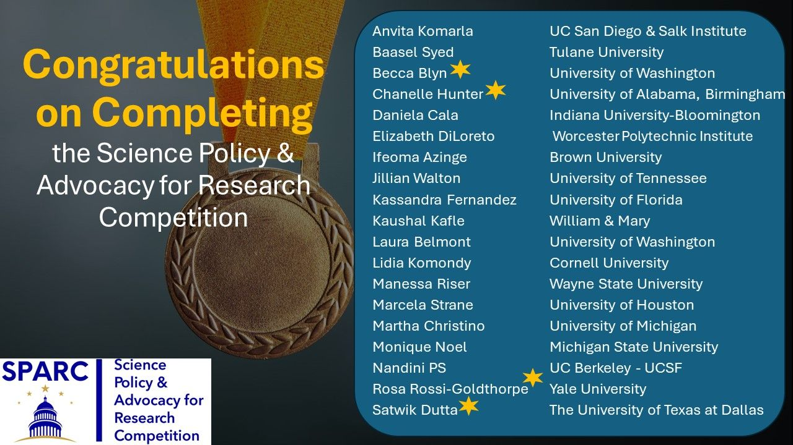
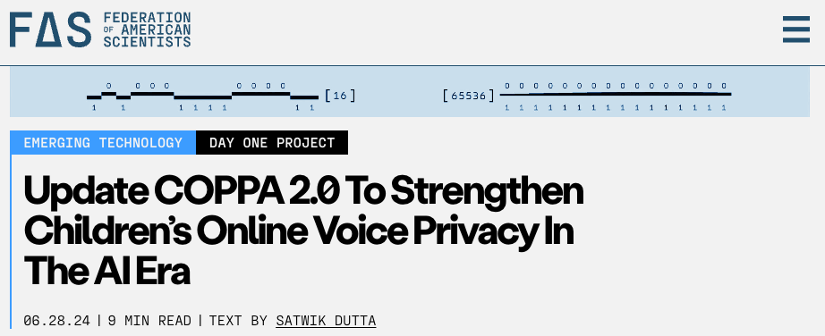
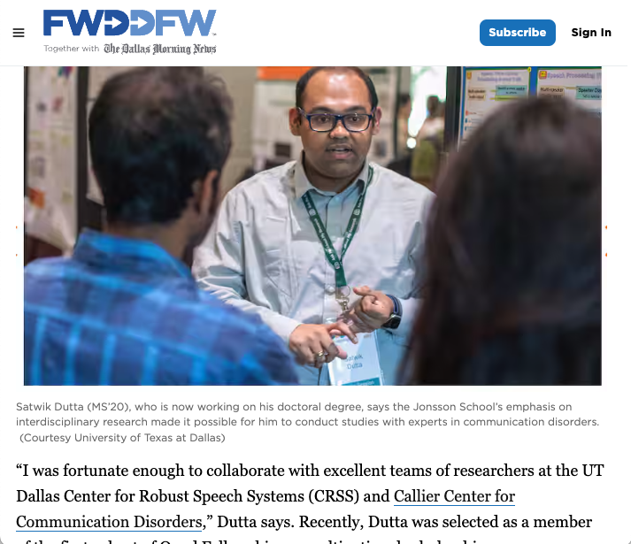
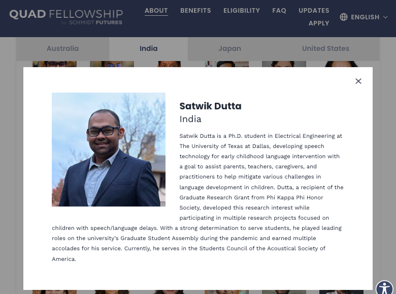
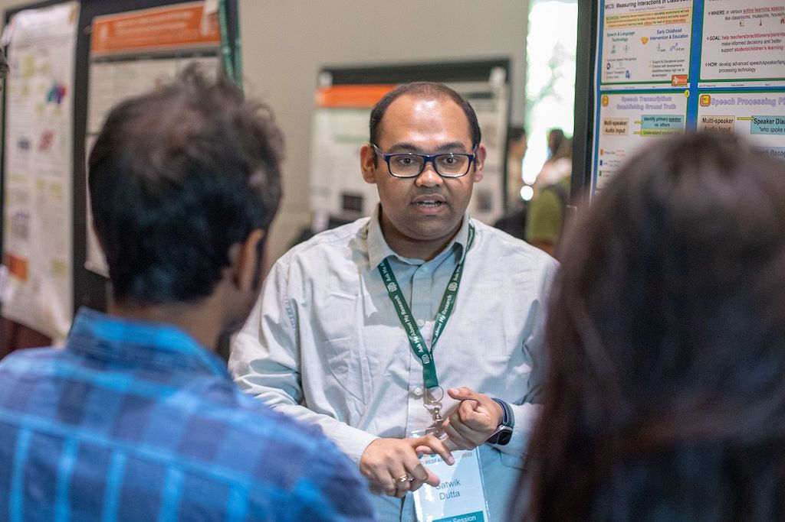

<article class="media-feature">
  

    August 2025
    <h2 class="media-feature__title"><a href="https://tacc.utexas.edu/news/latest-news/2025/08/22/kid-friendly-audio-ai/" target="_blank" rel="noopener noreferrer">Kid-Friendly Audio AI</a></h2>
    
Texas Advanced Computing Center

    <blockquote class="media-feature__quote">“Whatever we do, it should be trustworthy and ethical. I envision a safe digital future for all children.”</blockquote>
  

</article>

<article class="media-feature">
  

    April 2025
    <h2 class="media-feature__title"><a href="https://www.safeaiforchildren.org/saifca-advocates/" target="_blank" rel="noopener noreferrer">Meet Our SAIFCA Advocates</a></h2>
    
Safe AI for Children Alliance

    <blockquote class="media-feature__quote">“Satwik’s doctoral research aims to create trustworthy child-centered Speech/Voice AI.”</blockquote>
  

</article>

<article class="media-feature">
  

    March 2025
    <h2 class="media-feature__title"><a href="https://futurism.com/character-ai-google-test-ai-chatbots-kids" target="_blank" rel="noopener noreferrer">Did Google Test an Experimental AI on Kids, With Tragic Results?</a></h2>
    
<em>Futurism</em>

    <blockquote class="media-feature__quote">“We need to have guardrails to protect not only kids, but everyone, all of us.”</blockquote>
  

</article>

<article class="media-feature">
  

    January 2025
    <h2 class="media-feature__title"><a href="https://engineering-magazine.utdallas.edu/2024/12/10/global-influencer-satwik-dutta/" target="_blank" rel="noopener noreferrer">Global Influencer: Satwik Dutta MS’20</a></h2>
    
<em>Voyager</em>, University of Texas at Dallas

    <blockquote class="media-feature__quote">“I believe we should bring our expertise as researchers to the table.”</blockquote>
  

</article>

<article class="media-feature">
  

    August 2024
    <h2 class="media-feature__title"><a href="https://newdimensions.utdallas.edu/news-and-stories/portraits-of-impact/satwik-dutta/" target="_blank" rel="noopener noreferrer">Researcher Uses AI to Accelerate Early Childhood Language Intervention</a></h2>
    
<em>New Dimensions</em>, University of Texas at Dallas

    <blockquote class="media-feature__quote">“Most of my work has been to see how accurately we can understand what children are saying using AI for data-driven intervention.”</blockquote>
  

</article>

<article class="media-feature">
  

    July 2024
    <h2 class="media-feature__title"><a href="https://news.utdallas.edu/campus-community/accolades-july-2024/#:~:text=Researcher%20Earns%20Science%20Policy%20Recognition" target="_blank" rel="noopener noreferrer">Researcher Earns Science Policy Recognition</a></h2>
    
University of Texas at Dallas

    <blockquote class="media-feature__quote">“Receiving their feedback and appreciation has given me more confidence to continue my policy advocacy.”</blockquote>
  

</article>

<article class="media-feature">
  
  

    June 2024
    <h2 class="media-feature__title"><a href="https://ura-hq.org/sparc-science-policy-advocacy-for-research-competition-winners-announced/" target="_blank" rel="noopener noreferrer">SPARC Winners Announced</a></h2>
    
Universities Research Association

  

</article>

<article class="media-feature">
  
  

    March 2024
    <h2 class="media-feature__title"><a href="https://fas.org/accelerator/ai-legislation/" target="_blank" rel="noopener noreferrer">New Legislative Proposals to Deploy Artificial Intelligence Strategically</a></h2>
    
Federation of American Scientists

  

</article>

<article class="media-feature">
  
  

    February 2024
    <h2 class="media-feature__title"><a href="/posts/2024/02/dmn/">Jonsson School Is Preparing the Next Generation of Engineers and Computer Scientists</a></h2>
    
<em>The Dallas Morning News</em>

  

</article>

<article class="media-feature">
  
  

    2023
    <h2 class="media-feature__title"><a href="https://www.quadfellowship.org/the-quad-nations-announce-the-first-cohort-of-quad-fellows" target="_blank" rel="noopener noreferrer">The Quad Nations Announce the First Cohort of Quad Fellows</a></h2>
    
Quad Fellowship

  

</article>

<article class="media-feature">
  
  

    September 2022
    <h2 class="media-feature__title"><a href="https://news.utdallas.edu/campus-community/research-day-2022/" target="_blank" rel="noopener noreferrer">Innovation, Collaboration Come Together at First UTD Research Day</a></h2>
    
University of Texas at Dallas

  

</article>

<article class="media-feature">
  
  

    October 2021
    <h2 class="media-feature__title"><a href="https://youtu.be/XbLgLQKSRTo?feature=shared" target="_blank" rel="noopener noreferrer">ECE Study International — Satwik Dutta</a></h2>
    
University of Texas at Dallas

  

</article>

<article class="media-feature">
  

    2021
    <h2 class="media-feature__title"><a href="https://pulsar.utdallas.edu/doctoral-student-earns-national-research-university-service-awards/" target="_blank" rel="noopener noreferrer">Doctoral Student Earns National Research, University Service Awards</a></h2>
    
University of Texas at Dallas

    <blockquote class="media-feature__quote">“We reviewed many excellent submissions for this year’s award and believe you best exemplified the commitment, service, and leadership in student life.”</blockquote>
  

</article>

<article class="media-feature">
  

    2021
    <h2 class="media-feature__title"><a href="https://www.phikappaphi.org/grants-awards/graduate-research/2021-graduate-research-grant-recipients" target="_blank" rel="noopener noreferrer">2021 Graduate Research Grant Recipients</a></h2>
    
The Honor Society of Phi Kappa Phi

    <blockquote class="media-feature__quote">“Dutta will use funds from the award to support adult-child data collection efforts to develop speech technology solutions.”</blockquote>
  

</article>

<article class="media-feature">
  

    October 2020
    <h2 class="media-feature__title"><a href="https://www.ldc.upenn.edu/communications/newsletter/october-2020-newsletter" target="_blank" rel="noopener noreferrer">Fall 2020 LDC Data Scholarship Recipients</a></h2>
    
Linguistic Data Consortium

    <blockquote class="media-feature__quote">“Satwik is awarded copies of The CMU Kids Corpus LDC97263 and CLSU: Kids’ Speech Version 1.1. LDC2007S18 for his work in speech activity detection.”</blockquote>
  

</article>

