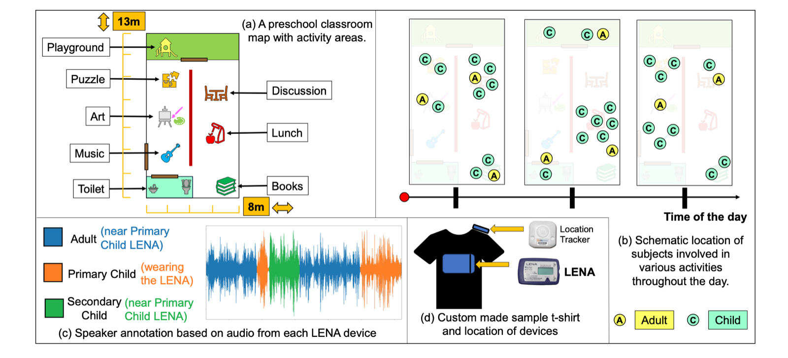
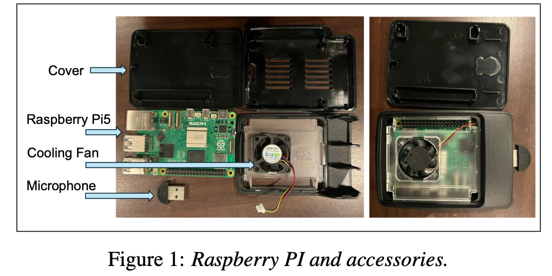
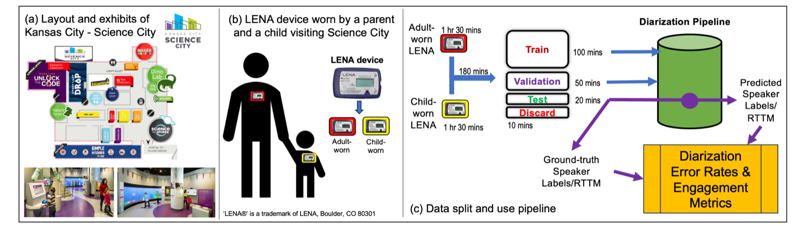
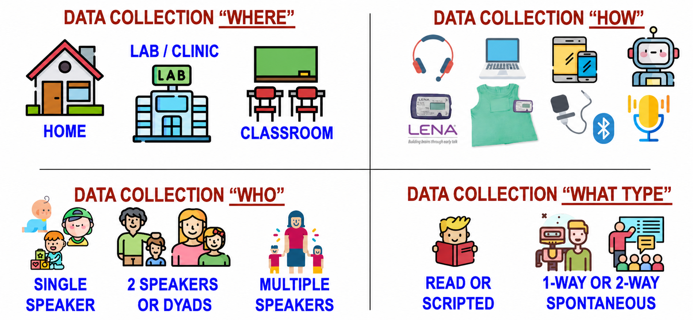
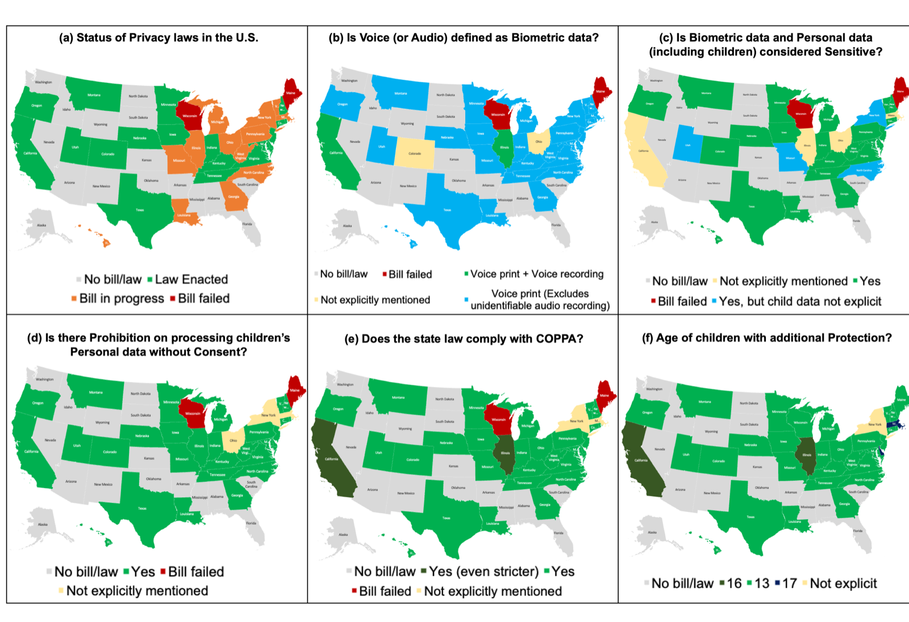
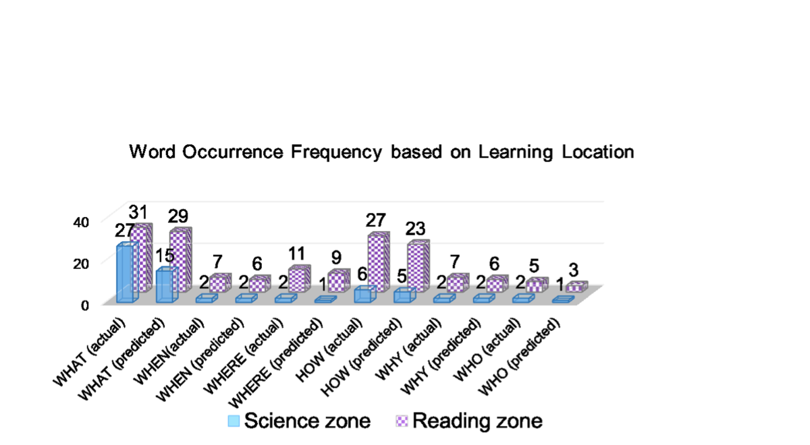

  <section class="research-intro" aria-labelledby="research-heading">
    <h2 class="research-intro__title" id="research-heading">Child-centered speech and voice AI</h2>
    
I develop speech technologies that work in the places children learn—classrooms, homes, museums, and tutoring environments—while treating privacy, efficiency, and equitable evaluation as core system requirements.

  </section>

  <nav class="research-nav" aria-label="Research themes">
    <a href="#child-asr">01Automatic Speech Recognition for Children</a>
    <a href="#private-efficient-asr">02Privacy-preserving and efficient child ASR</a>
    <a href="#child-adult-interactions">03Measuring child–adult interactions</a>
    <a href="#responsible-data-evaluation">04Responsible data and evaluation</a>
    <a href="#voice-privacy-policy">05Voice privacy and AI policy</a>
    <a href="#downstream-educational-applications">06Downstream Educational Applications</a>
  </nav>

  <article class="research-theme" id="child-asr">
    <header class="research-theme__header">
      01
      

        
Core speech technology

        <h2>Automatic Speech Recognition for Children</h2>
      

    </header>
    
My research builds ASR for preschool and school-aged children in naturalistic educational environments. Across three studies, it establishes robust hybrid baselines for spontaneous classroom speech, couples recognition with classroom location to recover activity-specific language measures, and introduces discrete speech units that reduce privacy and compute costs.

    <figure class="research-figure">
      
      <figcaption>Naturalistic preschool data collection combines wearable audio, speaker annotation, and real-time location. Figure from <a href="https://www.isca-archive.org/interspeech_2022/dutta22_interspeech.html" target="_blank" rel="noopener noreferrer">Dutta et al., INTERSPEECH 2022</a>.</figcaption>
    </figure>
    <section class="research-publications" aria-labelledby="child-asr-publications">
      <h3 id="child-asr-publications">Selected publications</h3>
      

        <article class="publication-card">
          <h4><a href="https://www.isca-archive.org/interspeech_2022/dutta22_interspeech.html" target="_blank" rel="noopener noreferrer">Challenges remain in Building ASR for Spontaneous Preschool Children Speech in Naturalistic Educational Environments</a></h4>
          
INTERSPEECH 2022

          
<strong>Contribution.</strong> Establishes hybrid-ASR baselines for spontaneous classroom speech from 3–5-year-olds with and without developmental delays, and shows that naturalistic child–adult interaction text improves language modeling.

          

Abstract

The study evaluates factorized TDNN acoustic models and n-gram and recurrent language models for low-resource preschool classroom speech. Comparisons with out-of-domain child corpora show that age, developing articulation, non-speech events, and recording context remain central challenges.

        </article>
        <article class="publication-card">
          <h4><a href="https://aclanthology.org/2022.bea-1.13/" target="_blank" rel="noopener noreferrer">Activity focused Speech Recognition of Preschool Children in Early Childhood Classrooms</a></h4>
          
BEA 2022 · Association for Computational Linguistics

          
<strong>Contribution.</strong> Fuses conversational speech with real-time classroom location and demonstrates recognition of spoken words, WH-words, and verbs within specific activity zones.

          

Abstract

A hybrid ASR system with an effective word error rate of about 40% is paired with location sensing in naturalistic preschool classrooms. The resulting activity-level measures illustrate how speech technology could support classroom assessment without relying entirely on direct observation.

        </article>
        <article class="publication-card">
          <h4><a href="https://www.sciencedirect.com/science/article/abs/pii/S1071581925000175" target="_blank" rel="noopener noreferrer">Exploring discrete speech units for privacy-preserving and efficient speech recognition for school-aged and preschool children</a></h4>
          
International Journal of Human-Computer Studies · 2025

          
<strong>Contribution.</strong> Achieves 15.7% WER on MyST using discrete speech units while matching much larger end-to-end systems more closely in performance than in model size or training cost.

          

Abstract

The paper tests whether discrete representations can preserve linguistic information needed for ASR while limiting speaker-specific information and waveform reconstruction. It compares discrete and end-to-end systems across multiple child-speech corpora and demonstrates activity-word recognition in preschool teacher–child interactions.

        </article>
      

    </section>
  </article>

  <article class="research-theme" id="private-efficient-asr">
    <header class="research-theme__header">
      02
      

        
Models and deployment

        <h2>Privacy-preserving and efficient child ASR</h2>
      

    </header>
    
My research pairs privacy-preserving representations with models small enough for local inference. The discrete-unit study reaches 15.7% WER with a substantially smaller, faster system; the edge-ASR study compresses Whisper for real-time Raspberry Pi deployment while reducing encoder size and computation.

    

      15.7% WER on MyST with discrete ASR
      Nearly 3× faster training
      On-device Raspberry Pi inference
    

    <figure class="research-figure research-figure--compact">
      
      <figcaption>Raspberry Pi 5 deployment setup. Figure from <a href="https://www.isca-archive.org/wocci_2025/dutta25_wocci.html" target="_blank" rel="noopener noreferrer">Dutta, Chandupatla &amp; Hansen, WOCCI 2025</a>.</figcaption>
    </figure>
    

      <a href="https://github.com/SatwikDutta/LiteChildASR" target="_blank" rel="noopener noreferrer">Code and model recipes</a>
    

    <section class="research-publications" aria-labelledby="private-efficient-publications">
      <h3 id="private-efficient-publications">Selected publications</h3>
      

        <article class="publication-card">
          <h4><a href="https://www.sciencedirect.com/science/article/abs/pii/S1071581925000175" target="_blank" rel="noopener noreferrer">Exploring discrete speech units for privacy-preserving and efficient speech recognition for school-aged and preschool children</a></h4>
          
International Journal of Human-Computer Studies · 2025

          
<strong>Contribution.</strong> Shows that discrete speech units can support competitive child ASR while limiting reliance on raw voice, cutting training time to roughly one-third of a much larger end-to-end baseline.

          

Abstract

A discrete-unit ASR model reaches 15.7% WER on MyST and is evaluated on additional school-aged and preschool corpora. The study examines privacy, efficiency, cross-corpus generalization, and the recognition of educationally relevant word categories in teacher–child interactions.

        </article>
        <article class="publication-card">
          <h4><a href="https://www.isca-archive.org/wocci_2025/dutta25_wocci.html" target="_blank" rel="noopener noreferrer">Adapting Whisper for Lightweight and Efficient Automatic Speech Recognition of Children for On-device Edge Applications</a></h4>
          
WOCCI 2025

          
<strong>Contribution.</strong> Compresses and deploys a child-adapted Whisper model on Raspberry Pi, reducing encoder size and computation while retaining real-time inference.

          

Abstract

The study fine-tunes Whisper tiny.en on MyST, evaluates filtering strategies, and applies low-rank encoder compression. It reports 15.9% WER overall, 11.8% on filtered speech, 1.26× faster GPU inference, roughly 2 fewer GFLOPS on Raspberry Pi, and real-time factors between 0.23 and 0.41.

        </article>
      

    </section>
  </article>

  <article class="research-theme" id="child-adult-interactions">
    <header class="research-theme__header">
      03
      

        
Speech in the wild

        <h2>Measuring child–adult interactions</h2>
      

    </header>
    
My research converts long, naturalistic recordings into interpretable measures of interaction. The museum study turns diarization into conversational-turn, initiation, response, and talk-time measures; the preschool ASR study establishes the transcription foundation for noisy classrooms; and the bilingual study jointly identifies speaker role and language in adult–toddler speech.

    

      Who spoke when?
      Conversational turns
      Initiations and responses
      Individual talk time
    

    <figure class="research-figure">
      
      <figcaption>Field setup and diarization pipeline for measuring parent–child engagement in a science museum. Figure from <a href="https://www.isca-archive.org/wocci_2025/dutta25b_wocci.html" target="_blank" rel="noopener noreferrer">Dutta et al., WOCCI 2025</a>.</figcaption>
    </figure>
    <section class="research-publications" aria-labelledby="interaction-publications">
      <h3 id="interaction-publications">Selected publications</h3>
      

        <article class="publication-card">
          <h4><a href="https://www.isca-archive.org/wocci_2025/dutta25b_wocci.html" target="_blank" rel="noopener noreferrer">Little Voices, Big Discoveries — Using Speaker Diarization to Assess Parent-Child Engagement within a Science Museum Scenario</a></h4>
          
WOCCI 2025

          
<strong>Contribution.</strong> Introduces an unobtrusive diarization pipeline for converting family museum audio into conversational turns, initiations and responses, and individual talk time.

          

Abstract

The proof-of-concept combines museum-staff perspectives with parent–child audio collected using LENA recorders in a noisy informal-learning environment. System performance is evaluated with diarization error rate and with engagement measures designed to be meaningful to museum and education stakeholders.

        </article>
        <article class="publication-card">
          <h4><a href="https://www.isca-archive.org/interspeech_2022/dutta22_interspeech.html" target="_blank" rel="noopener noreferrer">Challenges remain in Building ASR for Spontaneous Preschool Children Speech in Naturalistic Educational Environments</a></h4>
          
INTERSPEECH 2022

          
<strong>Contribution.</strong> Provides the classroom-ASR foundation needed to recover child speech from multi-speaker, activity-rich preschool recordings.

          

Abstract

The paper benchmarks hybrid acoustic and language models for spontaneous speech from preschool children with and without developmental delays. Results show the value of age- and interaction-matched text while documenting persistent errors associated with developing articulation and non-linguistic classroom events.

        </article>
        <article class="publication-card">
          <h4><a href="https://www.isca-archive.org/odyssey_2024/dutta24_odyssey.html" target="_blank" rel="noopener noreferrer">Joint Language and Speaker Classification in Naturalistic Bilingual Adult-Toddler Interactions</a></h4>
          
Odyssey 2024

          
<strong>Contribution.</strong> Jointly predicts English or Spanish and adult or child speech using self-supervised representations from naturalistic bilingual interactions.

          

Abstract

Using the Hoff Corpus at child ages 2½, 3, and 3½ years, the study compares XLSR-53 and HuBERT features in a multitask classifier. A trainable combination of representations across Transformer layers improves both tasks, particularly speaker classification, while child-language identification remains difficult.

        </article>
      

    </section>
  </article>

  <article class="research-theme" id="responsible-data-evaluation">
    <header class="research-theme__header">
      04
      

        
Corpora, benchmarks, and public infrastructure

        <h2>Responsible child-speech data and evaluation</h2>
      

    </header>
    
Responsible child-speech AI starts before model training. The corpus-practices paper organizes collection around who is recorded, what speech is needed, when and where recording occurs, and how trust, consent, quality control, triage, and annotation are handled. The Cornell leaderboard project carries those principles into subgroup-disaggregated ASR evaluation for K–12 tutoring audio.

    

      
<strong>Document the data</strong>Recording context, speaker roles, transcription quality, and collection conditions.

      
<strong>Disaggregate results</strong>Report aggregate and subgroup metrics rather than allowing one score to hide disparities.

      
<strong>Release public infrastructure</strong>Open baselines, reproducible recipes, and education-specific leaderboards.

    

    <figure class="research-figure">
      
      <figcaption>Core design dimensions for child-speech corpus collection: where data are collected, how recordings are captured, who is recorded, and what type of speech is elicited. Related paper: <a href="https://arxiv.org/abs/2507.12870" target="_blank" rel="noopener noreferrer">Hansen, Dutta &amp; Grand, SLaTE 2025</a>.</figcaption>
    </figure>
    
<strong>Current project.</strong> At Cornell, the <a href="https://k12-ai-infrastructure.org/cornell-university/" target="_blank" rel="noopener noreferrer">Open Leaderboards for Benchmarking ASR in Educational Contexts</a> will release child-optimized baselines, reproducible recipes, and aggregate and subgroup metrics across age, dialect, demographic cohort, and clinical speech differences.

    <section class="research-publications" aria-labelledby="responsible-data-publications">
      <h3 id="responsible-data-publications">Selected publication</h3>
      

        <article class="publication-card">
          <h4><a href="https://arxiv.org/abs/2507.12870" target="_blank" rel="noopener noreferrer">Best Practices and Considerations for Child Speech Corpus Collection and Curation in Educational, Clinical, and Forensic Scenarios</a></h4>
          
SLaTE 2025

          
<strong>Contribution.</strong> Provides an end-to-end framework for planning child-speech corpora, from study purpose and participant trust through human-subjects review, quality checks, triage, and annotation.

          

Abstract

The paper addresses the rapid developmental changes and privacy constraints that make technology-ready child-speech data difficult to collect. It structures decisions around who, what, when, and where to record, then offers practical guidance for collaboration, research protocols, corpus quality, and curation across educational, clinical, and forensic settings.

        </article>
      

    </section>
  </article>

  <article class="research-theme" id="voice-privacy-policy">
    <header class="research-theme__header">
      05
      

        
Technology, law, and governance

        <h2>Voice privacy and AI policy</h2>
      

    </header>
    
My research connects technical safeguards to law and governance. The legislative review maps how federal and state privacy rules treat voice, children’s data, and synthetic data; the FAS policy brief converts that analysis into concrete COPPA 2.0 recommendations covering audio exceptions, derived audio features, deidentification, and AI-generated avatars.

    

      Federal and state privacy law
      Children’s data protection
      Voice as biometric data
      Synthetic data governance
    

    <figure class="research-figure">
      
      <figcaption>U.S. state voice-privacy and children’s-data protections as analyzed in the paper; legislative data are current to June 24, 2024. Figure from <a href="https://www.isca-archive.org/syndata4genai_2024/dutta24_syndata4genai.html" target="_blank" rel="noopener noreferrer">Dutta &amp; Hansen, SynData4GenAI 2024</a>.</figcaption>
    </figure>
    <section class="research-publications" aria-labelledby="policy-publications">
      <h3 id="policy-publications">Selected publications</h3>
      

        <article class="publication-card">
          <h4><a href="https://www.isca-archive.org/syndata4genai_2024/dutta24_syndata4genai.html" target="_blank" rel="noopener noreferrer">Navigating the United States Legislative Landscape on Voice Privacy: Existing Laws, Proposed Bills, Protection for Children, and Synthetic Data for AI</a></h4>
          
SynData4GenAI 2024

          
<strong>Contribution.</strong> Maps enacted and proposed privacy laws across the United States, with specific attention to voice data, protections for children, and emerging rules for synthetic data.

          

Abstract

The paper reviews federal activity and legislation across all fifty states to show where recordings and voiceprints enter statutory definitions and where additional safeguards apply to children. It also examines how synthetic data is beginning to appear in AI policy as an alternative to sensitive human data.

        </article>
        <article class="publication-card">
          <h4><a href="https://fas.org/publication/childrens-online-voice-privacy/" target="_blank" rel="noopener noreferrer">Update COPPA 2.0 to Strengthen Children’s Online Voice Privacy in the AI Era</a></h4>
          
Federation of American Scientists · 2024

          
<strong>Contribution.</strong> Proposes targeted COPPA 2.0 language to close gaps around stored audio, extracted audio features, deidentification, and AI-generated representations of children.

          

Abstract

The policy brief argues that modern voice-AI systems create risks not captured by rules focused only on raw recordings. It recommends narrowing the audio-file exception, deleting derived features with source audio, defining deidentification practices, and treating AI-generated child avatars as protected personal information.

        </article>
      

    </section>
  </article>

  <article class="research-theme" id="downstream-educational-applications">
    <header class="research-theme__header">
      06
      

        
From speech signals to educational measures

        <h2>Downstream Educational Applications</h2>
      

    </header>
    
My research translates speech processing into measures for early childhood education and intervention. The ECRQ study automates teacher WH-word counts by location; the ASEE paper defines engagement through turns, topic initiations, and vocabulary complexity; the S4SG study evaluates smartphones as an accessible alternative to LENA; and the ICMI study measures WH-question frequency across Science and Reading zones.

    <figure class="research-figure research-figure--compact">
      
      <figcaption>Actual and ASR-predicted adult WH-word frequency across Science and Reading activity zones. Figure from <a href="https://doi.org/10.1145/3461615.3485440" target="_blank" rel="noopener noreferrer">Kothalkar et al., ICMI 2021</a>.</figcaption>
    </figure>
    <section class="research-publications" aria-labelledby="applications-publications">
      <h3 id="applications-publications">Selected publications</h3>
      

        <article class="publication-card">
          <h4><a href="https://www.sciencedirect.com/science/article/abs/pii/S0885200623001308" target="_blank" rel="noopener noreferrer">Capturing the quantity and location of adult wh-words in the preschool classroom using a sensing tool system</a></h4>
          
Early Childhood Research Quarterly · 2024

          
<strong>Contribution.</strong> Demonstrates that ASR combined with location sensing can automatically quantify teachers’ WH-words within preschool literacy activity areas.

          

Abstract

This proof-of-concept replaces limited direct observation with automated speech and location measures. The system identifies “what” as the most frequent adult WH-word, reveals changes across collection time points, and supports comparisons of the language exposure experienced by individual children.

        </article>
        <article class="publication-card">
          <h4><a href="https://peer.asee.org/39202" target="_blank" rel="noopener noreferrer">Quantifying Engagement in Preschool Classrooms — Conversational Turn-Taking &amp; Topic Initiations</a></h4>
          
ASEE Gulf-Southwest 2022

          
<strong>Contribution.</strong> Defines a combined measurement framework for conversational turns, topic initiations, and phonological vocabulary complexity rather than treating any single count as engagement.

          

Abstract

The study analyzes five adult–child sessions, including children with and without speech or language delays, to relate who initiates a topic, how long exchanges continue, and the complexity of target nouns. Adult initiations tend to elicit more turns, but the results show why turn counts must be interpreted alongside vocabulary measures.

        </article>
        <article class="publication-card">
          <h4><a href="https://www.isca-archive.org/s4sg_2022/dutta22_s4sg.html" target="_blank" rel="noopener noreferrer">Can Smartphones be a cost-effective alternative to LENA for Early Childhood Language Intervention?</a></h4>
          
Speech for Social Good 2022

          
<strong>Contribution.</strong> Shows, in a small unsupervised home study, that family smartphones can capture audio with signal quality and ASR performance comparable to dedicated LENA recorders.

          

Abstract

Three families recorded roughly ten hours of parent–child science-book reading with a LENA device and their own smartphone during the COVID-19 pandemic. Comparisons using speech-to-noise ratio and ASR word error rate support smartphones as a promising lower-cost collection option while documenting the study’s limited scale.

        </article>
        <article class="publication-card">
          <h4><a href="https://doi.org/10.1145/3461615.3485440" target="_blank" rel="noopener noreferrer">Measuring Frequency of Child-directed WH-Question Words for Alternate Preschool Locations using Speech Recognition and Location Tracking Technologies</a></h4>
          
ICMI 2021

          
<strong>Contribution.</strong> Connects adult and child ASR with location tracking to compare actual and predicted WH-question frequencies across preschool Science and Reading areas.

          

Abstract

Using daylong recordings from 48 classroom sessions, the study trains hybrid and end-to-end ASR systems for naturalistic adult and child speech. It then maps recognized WH-words to learning zones, showing how automated language measures could inform the design of spaces that encourage adult–child engagement.

        </article>
      

    </section>
  </article>

  <section class="earlier-research" id="earlier-research">
    
Selected foundations

    <h2>Earlier Research</h2>
    
Earlier projects established the signal-processing, clinical-speech, and multimodal foundations for the current research program.

    

      <article class="earlier-card">
        <h3>NeuroVAD</h3>
        
Real-time speech-activity detection from non-invasive magnetoencephalography signals using recurrent neural networks. <a href="https://doi.org/10.3390/s20082248" target="_blank" rel="noopener noreferrer">Journal article</a>

      </article>
      <article class="earlier-card">
        <h3>Prompted-speech activity detection</h3>
        
Automatic segmentation of preschool speech for scalable speech-sound-disorder screening and assessment. <a href="https://speakeasy.utdallas.edu/" target="_blank" rel="noopener noreferrer">SpeakEasy project</a>

      </article>
      <article class="earlier-card">
        <h3>Articulatory kinematics</h3>
        
Tongue and lip motion patterns as sensitive markers of speech-motor change in amyotrophic lateral sclerosis.

      </article>
      <article class="earlier-card">
        <h3>Silent speech and laryngectomy</h3>
        
Motion-based analysis and classification of voiced, silent, and alaryngeal speech. <a href="/files/2020_MotorSpeech.pdf" target="_blank" rel="noopener noreferrer">Research poster</a>

      </article>
    

  </section>

  
<a href="https://scholar.google.com/citations?hl=en&amp;authuser=1&amp;user=sZkQ4Y0AAAAJ" target="_blank" rel="noopener noreferrer">View all publications on Google Scholar →</a>

